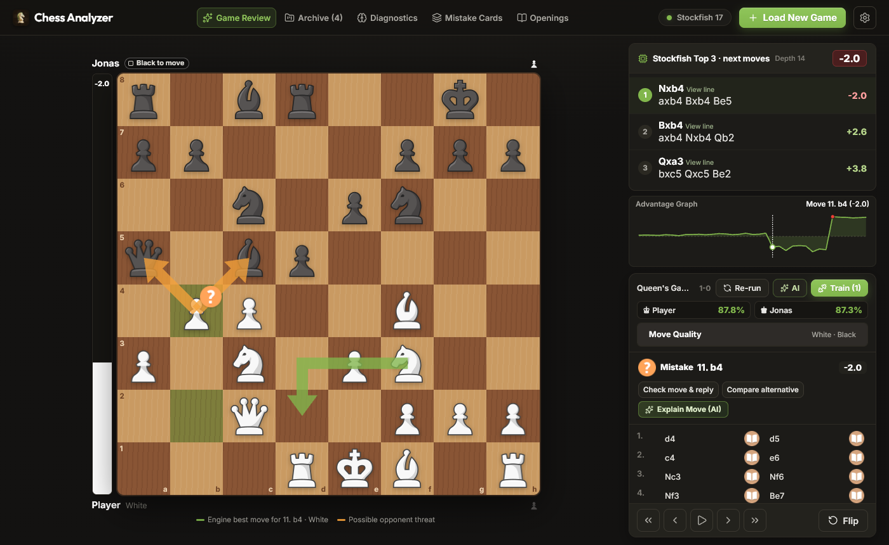
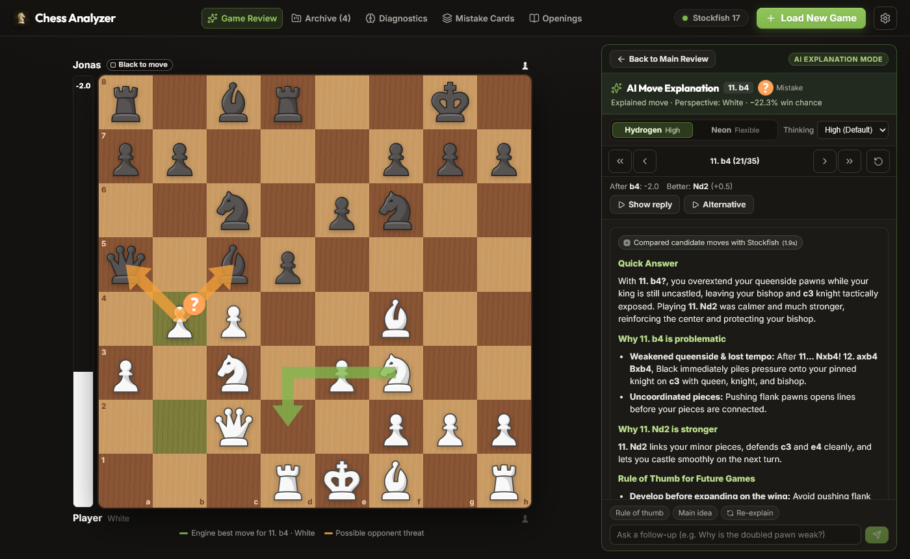
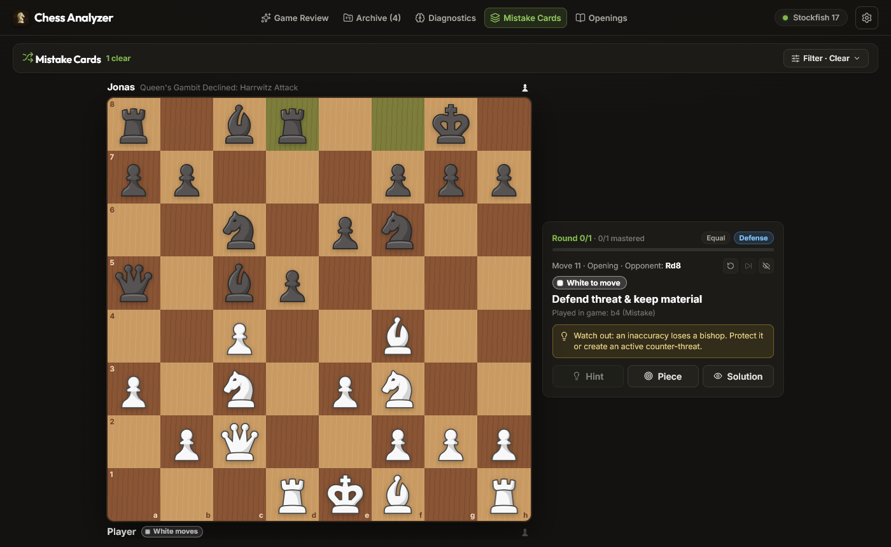
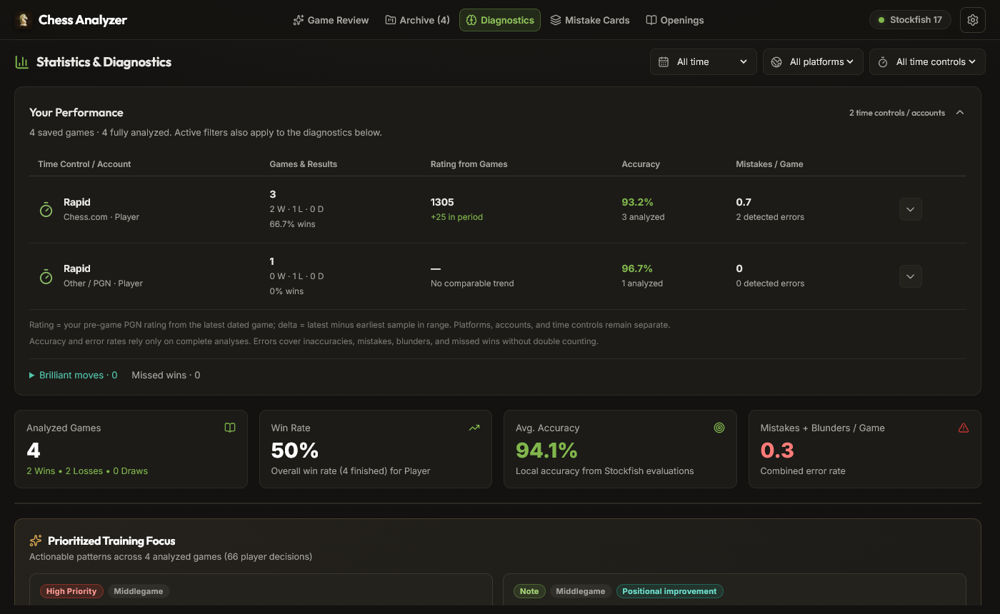
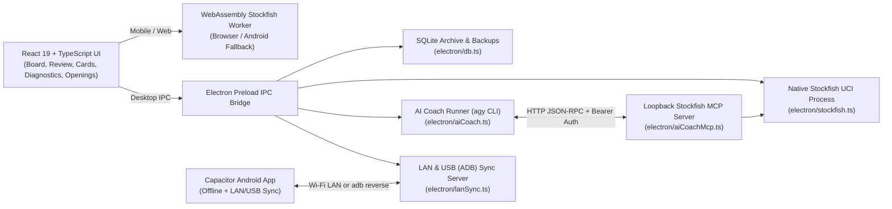

# Personal Chess Analyzer

[](https://github.com/simonkuhn-eng/Personal_Chess_Analyzer/actions/workflows/ci.yml)
[](LICENSE)


A local-first chess analysis, diagnostics, and spaced-repetition training app for Windows desktop and Android. Instead of just dumping engine centipawn numbers onto a board, it breaks down *why* a move went wrong, turns your own recurring mistakes into interactive board drills, and includes an optional Desktop AI Coach backed by real Stockfish tool calls.

---

## Screenshots

### Game Review & Move Explorer
Full move-by-move win-chance graph, top 3 Stockfish continuations, best-move/threat arrows, opening-book separation, and inline variation exploration.



### Desktop AI Move Coach (Stockfish MCP Tool Calling)
Explains mistakes in plain coaching principles ("rules of thumb") rather than 20-ply computer lines. Supports follow-up questions in context and optional Stockfish variation checks via an embedded MCP server (`compare_moves`, `evaluate_position`, `inspect_position`).



### Spaced-Repetition Mistake Cards
Automatically extracts your inaccuracies, mistakes, blunders, and missed wins into interactive flashcards with tactical/positional mission tags, second-chance refutation arrows, and deterministic review intervals up to 30-day mastery.



### Player Diagnostics & Performance Breakdown
Tracks form curves, error density across 10-move windows, advantage conversion & defensive resilience rates, opponent rating buckets, missed tactical motifs, and opening-window accuracy.



---

## Key Engineering Highlights

- **Reliable Evaluation Pipeline (`src/utils/analysis.ts`, `electron/stockfish.ts`):** Separates UCI opening-book tagging (`openingAnnotation`) from actual move quality so bad moves in theory are still flagged, validates search bounds/depths (`evaluationReliability.ts`), and verifies brilliant sacrifices with targeted follow-up searches.
- **Local MCP Server for AI Coaching (`electron/aiCoach.ts`, `electron/aiCoachMcp.ts`, `electron/chessPositionFacts.ts`):** Runs an authenticated loopback HTTP JSON-RPC MCP server alongside Stockfish so the coaching model can query candidate lines on demand while grounding explanations in computed structural chess facts (doubled/isolated pawns, pins, king safety).
- **Deterministic Spaced Repetition & Opening Trainer (`src/utils/reviews.ts`, `src/utils/trainingDeck.ts`, `src/utils/openingTraining.ts`):** Schedules cards based on unassisted solves vs. hint-assisted solves, detects checks/forks/missed wins, and offers an opening repertoire drill mode with live Stockfish sparring.
- **Offline-First Storage & LAN / USB Sync (`electron/db.ts`, `electron/lanSync.ts`):** Persists games locally in SQLite with atomic writes and schema backups, plus direct local-network (HTTP) or USB (`adb reverse`) two-way syncing between Desktop and Android without any cloud account.
- **Bilingual UI (`Deutsch` / `English`):** Instant live language switching in **Settings**.

---

## Architecture



---

## Quick Start (Development)

### Prerequisites
- **Node.js 20+** and **npm**
- **Stockfish desktop binary (optional for dev tests, required for local desktop analysis):** Download Stockfish for your platform (see `engine/README.txt`) and place it at `engine/stockfish.exe` (or configure a custom binary path in **Settings**).

### Install & Verify

```bash
git clone https://github.com/simonkuhn-eng/Personal_Chess_Analyzer.git
cd Personal_Chess_Analyzer
npm install

# Run TypeScript checks, unit tests, AI coach tests, training deck tests, and production build
npm run typecheck
npm test
npx tsx tests/aiCoach.mts
npx tsx tests/trainingDeckUpgrade.mts
npm run build
```

### Run Desktop App (Electron + Vite)

```bash
npm run dev:electron
```

### Build Windows Portable Package / Android Web Assets

```bash
# Windows portable desktop bundle
npm run package:win

# Sync web bundle to Capacitor Android project
npm run android:sync
```

> **Note on Desktop AI Move Coach:** The AI Coach panel is optional and available on Desktop when the `agy` CLI (`antigravity` / `agy`) is signed in on your machine. All core analysis, diagnostics, Chess.com/Lichess PGN imports, and training decks work completely offline without it.

---

## Privacy & Data Ownership

- Games, review cards, settings, and API sync cursors are stored **exclusively on your device** (local SQLite database on desktop, local app storage on mobile).
- Importing from Chess.com or Lichess only fetches public game archives for the username you enter—no account passwords or OAuth tokens are needed.
- Backup exports generate portable JSON archives that can be inspected or restored anytime from **Settings → Data & Backup**.

---

## License & Third-Party Notices

This project is released under the **MIT License** — see [LICENSE](LICENSE) for details.

Third-party components bundled or used:
- **Stockfish WebAssembly (`public/stockfish.js`):** Derived from [niklasf/stockfish.js](https://github.com/niklasf/stockfish.js) / Stockfish, licensed under **GNU GPLv3**.
- **chess.js:** Licensed under **BSD-2-Clause**.
- **Chess icons & UI icons:** `lucide-react` (ISC License).
